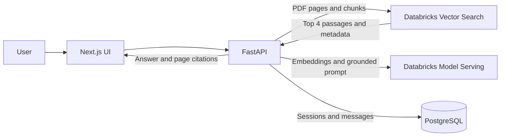

# PDF RAG | LangChain + Databricks

Upload PDFs, ask questions in natural language, and get answers grounded in retrieved passages with page citations. FastAPI powers the RAG API, Databricks provides embeddings, vector search, and chat serving, PostgreSQL stores conversation history, and a Next.js interface connects the experience.


## Architecture



## Workflow

1. **Upload and parse:** `POST /ingest` extracts PDF pages with `pypdf`, splits text into 1,000-character chunks with 150-character overlap, and retains the filename, 1-based page, and stable chunk ID.
2. **Index:** LangChain Databricks embeddings and `DatabricksVectorSearch` upsert chunks to a configured **Direct Vector Access** index.
3. **Retrieve and answer:** `POST /chat` retrieves the top four chunks, sends only those excerpts as context to the configured Databricks chat endpoint, and requests citations in `[filename, p. N]` format.
4. **Persist and continue:** The API returns the answer and distinct page citations, and stores user/assistant messages against a PostgreSQL session UUID. The browser retains the UUID for follow-up questions.

## Technology

| Layer | Stack |
| --- | --- |
| Backend | Python, FastAPI, LangChain, `databricks-langchain`, `pypdf`, psycopg 3 |
| Frontend | Next.js App Router, React, TypeScript |
| Services | Databricks Model Serving, Databricks Vector Search, PostgreSQL |

```text
backend/app/       API, PDF ingestion, RAG, PostgreSQL
backend/           Python requirements and environment example
frontend/app/      Next.js chat UI
frontend/          npm manifest and environment example
```

## Requirements

- Python 3.10+ and Node.js 20+ with npm.
- PostgreSQL 12+ and network access from the backend.
- A Databricks workspace and credentials authorized for the configured endpoints; a chat-serving endpoint; an OpenAI-compatible embedding-serving endpoint; and a Vector Search endpoint/index.

## Databricks index setup

Create a **Direct Vector Access** index in Unity Catalog and a Vector Search endpoint before ingestion. The index must support direct upserts; a Delta Sync index is not suitable for this upload flow.

Required index schema:

| Column | Type |
| --- | --- |
| `id` (primary key) | string |
| `text` | string |
| `text_vector` | array of floats, dimension matching the embedding endpoint |
| `source` | string |
| `page` | integer |
| `chunk_id` | string |

Set the index embedding vector column to `text_vector`; the application supplies embeddings through the configured model endpoint. Select an embedding model with a compatible dimension and set that dimension when creating the index. Index-creation SDK/API support is evolving, so create the endpoint and index in the Databricks UI or with your workspace's supported Vector Search API. This application does not create Databricks resources.

For local development, the LangChain Databricks integration uses SDK authentication through `DATABRICKS_HOST` and `DATABRICKS_TOKEN`. In production, prefer a least-privilege service principal/OAuth configuration over a personal token when available. The chat endpoint must accept LangChain `ChatDatabricks` requests; the embedding endpoint must accept `DatabricksEmbeddings` requests.

## Configure and run

Copy the example environment files and replace the placeholders. Never commit local environment files.

```sh
cp backend/.env.example backend/.env
cp frontend/.env.example frontend/.env.local
```

Set every `DATABRICKS_*` endpoint/credential value in `backend/.env` and configure `DATABASE_URL` as a PostgreSQL connection URL. `FRONTEND_ORIGIN` defaults to `http://localhost:3000`. If the backend is not at `http://localhost:8000`, set `NEXT_PUBLIC_API_URL` in `frontend/.env.local`.

Create a PostgreSQL database and user, and grant the user permission to create tables in that database/schema. On the first chat request, the API automatically creates the `sessions` and `messages` tables and an index. Chat history is stored in the configured PostgreSQL database; PDFs and extracted text are stored in the configured Databricks index.

Start the API from the repository root:

```sh
cd backend
python -m venv .venv
source .venv/bin/activate
pip install -r requirements.txt
uvicorn app.main:app --reload
```

In another terminal, start the web app:

```sh
cd frontend
npm install
npm run dev
```

Open <http://localhost:3000>, choose a PDF with **Choose a PDF**, select **Index PDF**, and ask a question. The health endpoint is <http://localhost:8000/health>.

## API

### `GET /health`

Reports PostgreSQL availability and whether required Databricks configuration values are present. It does not probe Databricks endpoints.

### `POST /ingest`

Accepts `multipart/form-data` with a `file` field containing a PDF.

```sh
curl -F 'file=@report.pdf' http://localhost:8000/ingest
```

```json
{"filename":"report.pdf","chunks_indexed":18}
```

### `POST /chat`

Accepts a question and an optional session UUID.

```sh
curl -X POST http://localhost:8000/chat \
  -H 'Content-Type: application/json' \
  -d '{"question":"What are the main findings?"}'
```

```json
{
  "session_id":"00000000-0000-0000-0000-000000000000",
  "answer":"The report identifies ... [report.pdf, p. 3]",
  "citations":[{"filename":"report.pdf","page":3}]
}
```

Reuse the returned `session_id` for follow-up questions. Citations use 1-based PDF page numbers: the answer includes inline `[filename, p. N]` references, and `citations` contains unique source pages as structured values.

## Limitations

- `/health` reports `degraded` until PostgreSQL is reachable and all Databricks environment values are set. Missing configuration, unavailable services, invalid/non-text PDFs, and indexing failures return HTTP errors; check credentials, endpoint permissions, index schema and embedding dimension, and that the index is Direct Vector Access.
- Scanned/image-only PDFs have no extractable text; OCR is not implemented. Password-protected PDFs and oversized uploads may fail. Upload capacity is limited by available memory and API server request-size limits.
- Databricks and PostgreSQL resources/credentials were not available in this repository environment; external integrations have not been exercised here.
- This MVP has no authentication, per-user document isolation, streaming responses, or document deletion. It is a minimal starting point, not a production deployment.
